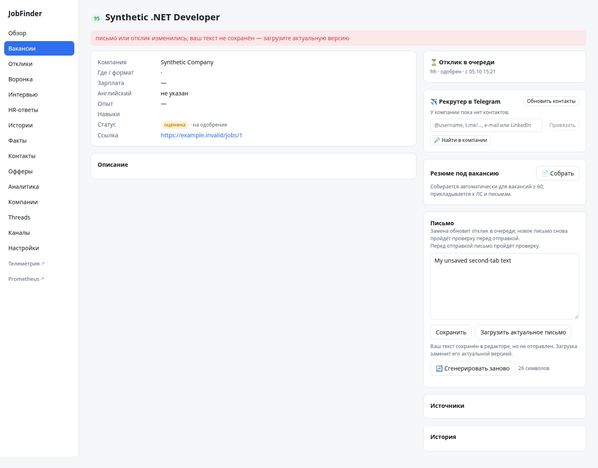
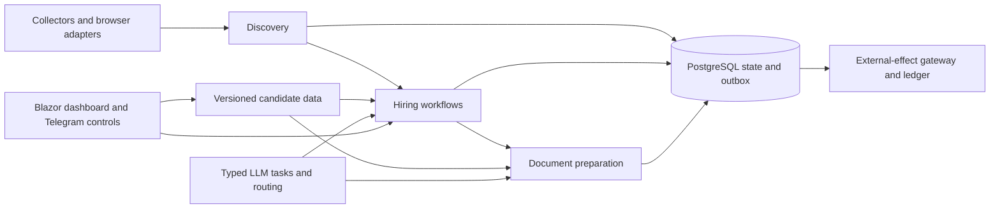

# JobFinder — Durable .NET Workflow Engineering

A sanitized source snapshot of my personal job-search system, published to demonstrate **reliable workflow execution, AI integration, concurrency control, and external-effect handling** in .NET 10.

**Author:** Terentiy Gatsukov · **Stack:** ASP.NET Core / Blazor, PostgreSQL / EF Core, Wolverine, OpenTelemetry, Playwright, Telegram, SMTP/IMAP.



*Actual application components on synthetic acceptance data. The screenshot shows a stale edit being refused while preserving the typed draft; it does not show a real vacancy, account, or employer interaction.*

## Why this project is here

Collecting vacancies is the product context. The engineering problems are broader: a database commit and a remote delivery cannot be one transaction; a paid LLM result should survive a retry; a stale browser tab must not overwrite newer state; process death must not silently lose queued work.

| Problem | Implemented approach | Start reading |
| --- | --- | --- |
| State and next command must commit together | Wolverine + EF transactional outbox + native PostgreSQL transport | [Messaging boundaries](docs/WOLVERINE.md), [compatibility tests](tests/JobFinder.Tests/Pipeline/WolverineIntegrationTests.cs) |
| A send may have happened before the process failed | Attempt ledger, explicit unknown outcome, operator reconciliation; uncertain effects are not automatically replayed | [Employer workflow](src/JobFinder.Pipeline/Modules/Hiring/EmployerMessageWorkflow.cs) |
| Input changes while work is in flight | Captured source/candidate/policy versions, immutable revisions, atomic publication checks | [Candidate ownership](docs/CANDIDATE.md), [post-processing workflow](src/JobFinder.Pipeline/Modules/Discovery/PostProcessingWorkflow.cs) |
| Providers disagree or ignore JSON schemas | Typed task catalog, local schema and semantic validation, routing and model health | [LLM task ownership](docs/LLM-TASKS.md), [contract tests](tests/JobFinder.Tests/Llm/NativeWireContractTests.cs) |
| Retry repeats expensive drafting | Saved stage results and versioned recipe hashes; checkpointed Draft / Print / Review / Finish | [Resume workflow](src/JobFinder.Pipeline/Modules/Preparation/ResumePreparationWorkflow.cs) |
| UI conflict destroys a user's edits | Displayed revision witnesses and retained drafts, with explicit reload | [Synthetic UI evidence](docs/images/edit-conflict.png) |

## Architecture



One application process and PostgreSQL, with feature-owned workflows rather than a collection of independent CRUD controllers. See [ARCHITECTURE.md](docs/ARCHITECTURE.md) and [the migration record](docs/REFACTORING.md) for decisions and unfinished boundaries.

## Verification

Publication review on 2026-10-07 rebuilt the source with **zero warnings and zero errors**. Core/LLM tests and native PostgreSQL/Wolverine compatibility tests passed against disposable infrastructure. Exact results for this sanitized snapshot are in [PUBLICATION-VERIFICATION.md](docs/PUBLICATION-VERIFICATION.md).

The source also contains historical acceptance documentation reporting **3,236 tests passed on 2026-10-05**. That historical whole-suite result is separate from the publication checks and must not be presented as a new full-suite run.

## Build and inspect

Requires .NET SDK **10.0.401** (or a compatible later SDK). Integration tests require Docker.

```bash
dotnet build JobFinder.slnx -c Release
# Pure domain rules, contracts and provider doubles:
dotnet tests/JobFinder.Tests/bin/Release/net10.0/JobFinder.Tests.dll \
  -namespace JobFinder.Tests.Core -namespace JobFinder.Tests.Llm -maxThreads 4
# Actual PostgreSQL transport, transaction and recovery seams:
dotnet tests/JobFinder.Tests/bin/Release/net10.0/JobFinder.Tests.dll \
  -class JobFinder.Tests.Pipeline.WolverineIntegrationTests -maxThreads 4
```

The source snapshot includes the application and adapters, but personal resumes, accounts, credentials, session data and the original channel subscriptions are excluded. This is **not a ready-to-run hosted job-search service**. The screenshots are the credential-free way to inspect the application UI; live integrations require a deliberately configured personal environment.

## Scope and provenance

This repository begins with a sanitized snapshot of private source commit `2925785`, retaining engineering documentation and synthetic tests. Recorded web fixtures have unnecessary script bodies removed. The working private repository and its Git history remain private. No real employer messages, account logins, provider probes or production migrations were executed for this publication.

Database and transport tests establish specific recovery boundaries; they do not imply exactly-once remote sends or exactly-once paid provider execution. Live provider quality, deployed account behavior, all workflow cutovers and production performance remain separate acceptance work.

Development includes AI-assisted implementation. Architecture, constraints, verification and final review remain my responsibility. This is public source for review; no open-source reuse license has been added.
